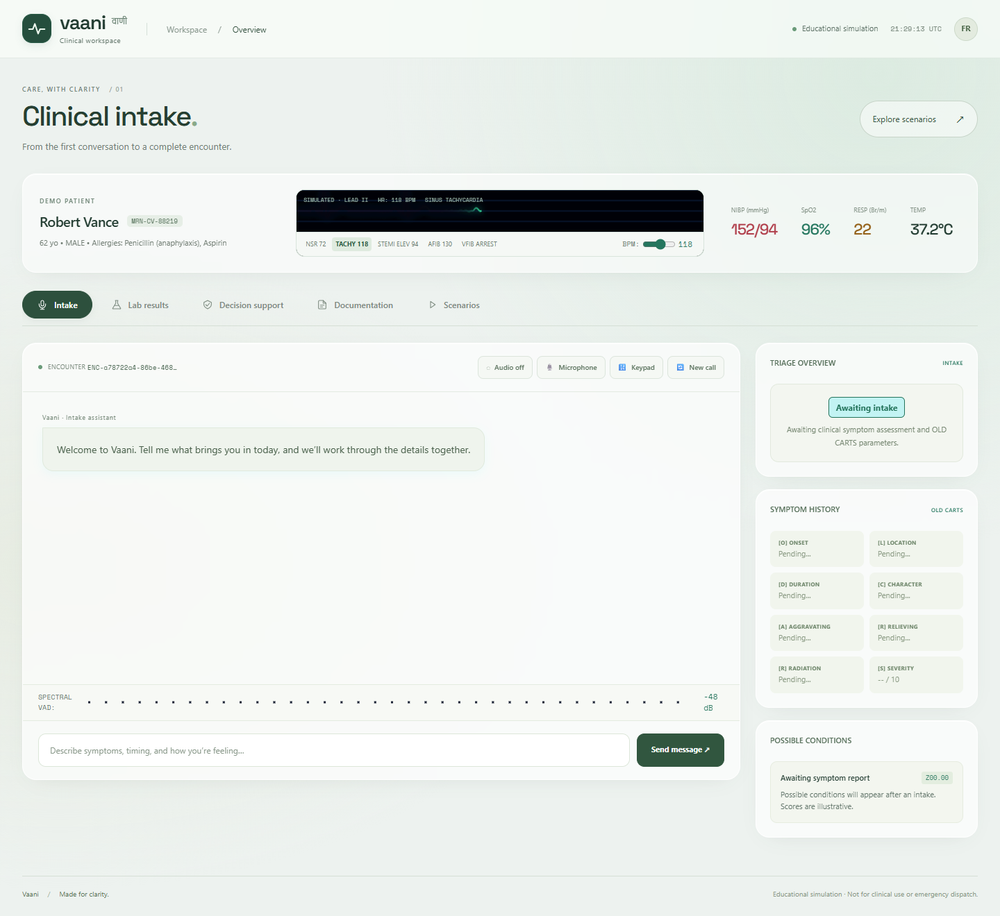
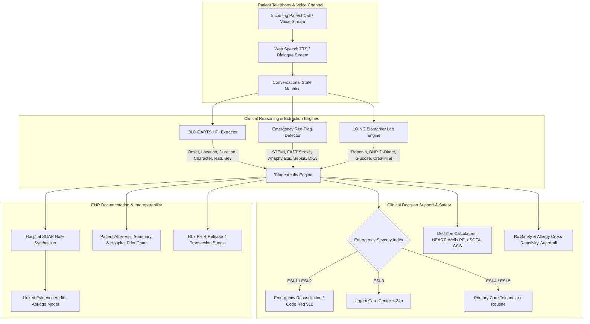

# Vaani Clinical (वाणी) — Clinical Intake and Documentation Simulation

[](https://www.python.org/downloads/)
[](https://fastapi.tiangolo.com/)
[](https://hl7.org/fhir/R4/)
[]()
[](https://opensource.org/licenses/MIT)

> **Vaani (वाणी)** — Sanskrit/Hindi for *Voice*, *Speech*, or *The Spoken Word*.  
> An educational simulation for guided clinical intake, illustrative decision support, SOAP notes and FHIR R4 export.

---


## Pearl workspace

A pearl clinical workspace with deep teal surfaces, crisp typography, guided intake prompts, live encounter progress, responsive layouts, and restrained transitions. The five workspaces cover intake, lab results, decision support, documentation, and scenarios. Motion respects the system's reduced-motion preference; dialogs support keyboard focus and Escape.



Vaani is an educational simulation. Waveforms and vitals are simulated, scores are illustrative, and the escalation control does not place a call or dispatch emergency services. Generated content needs professional review; no hospital affiliation, physician credential, or compliance certification is implied by the interface.

## 🏥 Architecture Overview



---

## Capabilities

1. **Conversational State Machine & OLD CARTS HPI Investigation**
   - Automatically guides incoming telephony calls through 5 clinical phases: `INTAKE` $\rightarrow$ `HPI_INVESTIGATION` $\rightarrow$ `MEDS_ALLERGIES` $\rightarrow$ `ASSESSMENT` $\rightarrow$ `DISPOSITION`.
   - Autonomously detects missing OLD CARTS dimensions (Onset, Location, Duration, Character, Aggravating, Relieving, Radiation, Severity 1–10) and formulates natural medical follow-up queries.

2. **Emergency Red-Flag Ruleout Protocol & ESI Scoring**
   - Implements Emergency Severity Index (ESI Levels 1 to 5) algorithm.
   - Immediate detection of life-threatening presentations:
     - **Acute Coronary Syndrome (STEMI / NSTEMI)**: Crushing substernal chest pressure, left arm / jaw radiation, diaphoresis $\rightarrow$ `ESI-1`.
     - **Acute Stroke (FAST Protocol)**: Facial droop, unilateral arm weakness, slurred speech $\rightarrow$ `ESI-1`.
     - **Anaphylaxis**: Acute airway edema, bronchospasm, urticaria $\rightarrow$ `ESI-1`.
     - **Diabetic Ketoacidosis (DKA)**: Blood glucose $> 250$ mg/dL, fruity breath, Kussmaul breathing $\rightarrow$ `ESI-2`.
     - **Pulmonary Embolism & Tension Pneumothorax**: Pleuritic chest pain, hemoptysis, DVT risk $\rightarrow$ `ESI-2`.
     - **Systemic Sepsis**: Rigors, hypothermia/hyperthermia, altered sensorium $\rightarrow$ `ESI-2`.

3. **LOINC Lab Biomarker Extraction (Inspired by Sehatlings-Muaina)**
   - Unstructured clinical lab text parser matching standard panels:
     - **Cardiac**: Troponin I (`LOINC 10839-9`), BNP (`LOINC 33762-6`), D-Dimer (`LOINC 48065-7`).
     - **Endocrine / Metabolic**: Fasting Blood Glucose (`LOINC 1558-6`), HbA1c (`LOINC 4548-4`).
     - **Renal & Electrolytes**: Creatinine (`LOINC 2160-0`), eGFR (`LOINC 33914-3`), Potassium (`LOINC 2823-3`), Sodium (`LOINC 2951-2`).
     - **Hematology**: Hemoglobin (`LOINC 718-7`), WBC (`LOINC 6690-2`).
     - **Hepatic**: ALT (`LOINC 1742-6`), AST (`LOINC 1920-8`).
   - Automatically computes quantitative bounds: `NORMAL`, `ELEVATED`, `CRITICALLY_HIGH`, `LOW`, and `CRITICALLY_LOW`.

4. **Clinical Decision Risk Calculators**
   - **HEART Score**: Stratifies 6-week Major Adverse Cardiac Events (MACE) risk in chest pain.
   - **Wells' Criteria for PE**: Determines two-tier (PE Likely vs Unlikely) and three-tier pulmonary embolism probability and D-dimer threshold.
   - **qSOFA Score**: Quick Sepsis-related Organ Failure Assessment detecting in-hospital mortality risk.
   - **Glasgow Coma Scale (GCS)**: Neurological conscious level rating (Eye, Verbal, Motor) with airway compromise alert.

5. **Rx Safety & Allergy Cross-Reactivity Guardrail**
   - Cross-checks planned triage pharmacotherapy against patient allergies (Penicillins, Cephalosporins, Sulfas, Aspirin/NSAIDs, Opioids) and active medications.
   - Prevents fatal anaphylaxis, bronchospasm (Samter's Triad), and drug-drug bleeding interactions with safe alternative recommendations (e.g., Clopidogrel substitute for Aspirin allergy in STEMI).

6. **Linked Evidence & Grounding Audit (Abridge Architecture)**
   - Maps synthesized clinical claims directly back to verbatim quotes from the patient transcript.
   - Calculates grounding confidence scores and hallucination risk indices to ensure medico-legal auditability.

7. **Patient After-Visit Summary (AVS) & Hospital Printable Chart**
   - Translates complex medical diagnoses into compassionate, 6th-grade reading level patient-facing discharge instructions.
   - Includes full-screen Hospital Encounter Chart modal (Epic / Cerner formatted) ready for instant printing or PDF export.

8. **Pearl Workspace & Simulated Telemetry**
   - Lead II cardiac monitor with live arrhythmia selector: Normal Sinus Rhythm, Sinus Tachycardia, STEMI Elevation, Atrial Fibrillation, and Ventricular Fibrillation Arrest.
   - Real-time HR slider adjusting mathematical canvas rendering speed.
   - Dual-Tone Multi-Frequency (DTMF) dial pad synthesizer emitting genuine telephony audio tones.
   - Real browser microphone stream capture via Web Audio API with live decibel VU meter and spectral VAD.

---

## 📁 Repository Structure

```
vaani-clinical/
├── backend/
│   ├── __init__.py
│   ├── models.py               # Pydantic v2 schemas (OLD CARTS, SOAP, FHIR v4)
│   ├── clinical_triage.py      # Conversational triage engine & red flag ruleout
│   ├── biomarker_extractor.py  # LOINC lab extraction & reference range analysis
│   ├── clinical_calculators.py # HEART, Wells PE, qSOFA, GCS calculators
│   ├── rx_safety.py            # Drug-allergy interaction & cross-reactivity guardrail
│   ├── evidence_grounding.py   # Linked evidence transcript mapping (Abridge model)
│   ├── avs_generator.py        # Patient After-Visit Summary generator
│   ├── soap_synthesizer.py     # Medical SOAP documentation generator
│   ├── fhir_generator.py       # HL7 FHIR v4 JSON transaction bundle builder
│   ├── scenarios.py            # 5 preset clinical simulation scenarios
│   ├── db.py                   # SQLite persistence layer
│   └── main.py                 # FastAPI application & REST endpoints
├── frontend/
│   ├── index.html              # Five clinical workspaces
│   ├── css/
│   │   └── vaani.css           # Base layout and clinical components
│   ├── fonts/
│   │   ├── SpaceGrotesk-Variable.woff2
│   │   ├── SpaceMono-400.woff2
│   │   └── Doto-Variable.woff2
│   └── js/
│       └── app.js              # ECG canvas, arrhythmia math, DTMF synthesizer, TTS/STT
├── tests/
│   ├── __init__.py
│   ├── test_triage.py          # OLD CARTS & red flag unit tests
│   ├── test_biomarkers.py      # Biomarker extraction & clinical status tests
│   ├── test_calculators.py     # HEART, Wells, qSOFA, GCS unit tests
│   ├── test_rx_safety.py       # Drug-allergy & cross-reactivity safety tests
│   ├── test_avs_grounding.py   # AVS & Linked Evidence grounding tests
│   ├── test_soap_fhir.py       # SOAP and FHIR bundle integration tests
│   └── test_api.py             # FastAPI REST endpoint integration tests
├── .gitignore
├── start.bat                   # 1-Click Windows startup launcher
├── run.ps1                     # PowerShell startup launcher
└── README.md                   # Comprehensive technical documentation
```

---

## 🚀 Quickstart Guide

### 1. Prerequisites
- Python 3.10 or higher
- Modern web browser (Chrome, Edge, Firefox, Brave)

### 2. Installation
Clone repository and install dependencies:
```bash
git clone https://github.com/ZephyrusZorro/vaani-clinical.git
cd vaani-clinical
pip install -r requirements-dev.txt
```

### 3. Launching the Workstation
Run with one double-click or command:
```cmd
start.bat
```
Or via PowerShell:
```powershell
.\run.ps1
```
Or directly via Python:
```bash
python -m uvicorn backend.main:app --host 127.0.0.1 --port 8001 --reload
```
Navigate to **`http://127.0.0.1:8001`** in your browser.

---

## 🧪 Automated Test Suite (43 passing)

Run the full pytest suite:
```bash
python -m pytest tests/ -v
```

Expected output:
```
tests/test_api.py::test_health_endpoint PASSED
tests/test_api.py::test_scenarios_endpoints PASSED
tests/test_api.py::test_triage_message_endpoint PASSED
tests/test_api.py::test_biomarker_extraction_endpoint PASSED
tests/test_api.py::test_soap_generation_endpoint PASSED
tests/test_api.py::test_fhir_generation_endpoint PASSED
tests/test_api.py::test_list_encounters_endpoint PASSED
tests/test_api.py::test_heart_calculator_endpoint PASSED
tests/test_api.py::test_wells_pe_endpoint PASSED
tests/test_api.py::test_qsofa_endpoint PASSED
tests/test_api.py::test_gcs_endpoint PASSED
tests/test_api.py::test_rx_safety_endpoint PASSED
tests/test_api.py::test_avs_endpoint PASSED
tests/test_avs_grounding.py::test_avs_generation PASSED
tests/test_avs_grounding.py::test_evidence_grounding PASSED
tests/test_biomarkers.py::test_cardiac_biomarker_extraction PASSED
tests/test_biomarkers.py::test_metabolic_biomarker_extraction PASSED
tests/test_biomarkers.py::test_renal_biomarker_extraction PASSED
tests/test_biomarkers.py::test_normal_hematology PASSED
tests/test_calculators.py::test_heart_score_high_risk PASSED
tests/test_calculators.py::test_heart_score_low_risk PASSED
tests/test_calculators.py::test_wells_pe_likely PASSED
tests/test_calculators.py::test_wells_pe_unlikely PASSED
tests/test_calculators.py::test_qsofa_septic_alert PASSED
tests/test_calculators.py::test_gcs_coma_score PASSED
tests/test_rx_safety.py::test_penicillin_allergy_contraindication PASSED
tests/test_rx_safety.py::test_penicillin_cephalosporin_cross_reactivity PASSED
tests/test_rx_safety.py::test_aspirin_allergy_in_stemi PASSED
tests/test_rx_safety.py::test_anticoagulant_antiplatelet_bleeding_interaction PASSED
tests/test_rx_safety.py::test_safe_pharmacotherapy PASSED
tests/test_soap_fhir.py::test_soap_synthesis PASSED
tests/test_soap_fhir.py::test_fhir_bundle_generation PASSED
tests/test_triage.py::test_oldcarts_extraction PASSED
tests/test_triage.py::test_stemi_red_flag_detection PASSED
tests/test_triage.py::test_stroke_fast_red_flag_detection PASSED
tests/test_triage.py::test_anaphylaxis_red_flag_detection PASSED
tests/test_triage.py::test_dka_red_flag_detection PASSED
tests/test_triage.py::test_routine_presentation_scoring PASSED
tests/test_triage.py::test_process_triage_turn PASSED
============================== 43 passed (current suite; timing varies) ==============================
```

---

## ⚖️ Clinical Disclaimer
*Vaani Clinical uses synthetic cases to demonstrate conversational state, illustrative decision rules and FHIR R4 bundle export.*

## Browser verification

Install optional browser-test dependencies with `python -m pip install -r requirements-dev.txt`. The scripts below use an installed Microsoft Edge browser via Playwright. Start the server, then run:

```powershell
python -m pytest -q
python tests/browser_regressions.py http://127.0.0.1:8001
python tests/browser_smoke.py http://127.0.0.1:8001
python tests/browser_product.py http://127.0.0.1:8001
```

Browser tests create synthetic encounters in the local database. Use a disposable checkout for a clean demonstration database. The legacy `test_e2e_frontend.py` is an opt-in API walkthrough and no longer performs network requests during pytest collection.

See [redesign verification](docs/interface-verification.md) for checked flows and boundaries.
