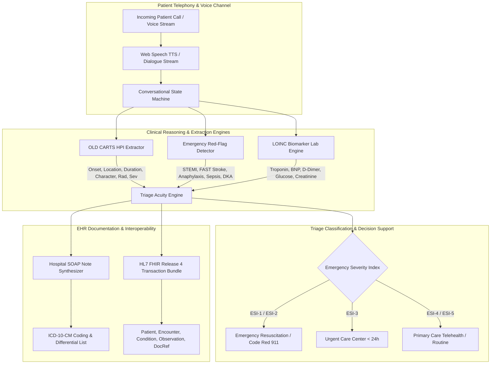

# Vaani Clinical (वाणी) — Real-Time Clinical Voice Receptionist & Medical Triage Intelligence

[](https://www.python.org/downloads/)
[](https://fastapi.tiangolo.com/)
[](https://hl7.org/fhir/R4/)
[]()
[](https://opensource.org/licenses/MIT)

> **Vaani (वाणी)** — Sanskrit/Hindi for *Voice*, *Speech*, or *The Spoken Word*.  
> A real-time clinical telephony receptionist, conversational triage copilot, and automated electronic health record (EHR) synthesis platform.

---

## 🏥 Architecture Overview



---

## 🌟 Key Innovations

1. **Conversational State Machine & OLD CARTS HPI Investigation**
   - Automatically guides incoming telephony calls through 5 clinical phases: `INTAKE` $\rightarrow$ `HPI_INVESTIGATION` $\rightarrow$ `MEDS_ALLERGIES` $\rightarrow$ `ASSESSMENT` $\rightarrow$ `DISPOSITION`.
   - Autonomously detects missing OLD CARTS dimensions (Onset, Location, Duration, Character, Aggravating, Relieving, Radiation, Severity 1–10) and formulates natural medical follow-up queries.

2. **Emergency Red-Flag Ruleout Protocol & ESI Scoring**
   - Implements Emergency Severity Index (ESI Levels 1 to 5) algorithm.
   - Detects life-threatening emergencies with zero latency:
     - **Acute Coronary Syndrome (STEMI / NSTEMI)**: Crushing substernal chest pressure, left arm / jaw radiation, diaphoresis $\rightarrow$ `ESI-1`.
     - **Acute Stroke (FAST Protocol)**: Facial droop, unilateral arm weakness, slurred speech $\rightarrow$ `ESI-1`.
     - **Anaphylaxis**: Acute airway edema, bronchospasm, urticaria $\rightarrow$ `ESI-1`.
     - **Diabetic Ketoacidosis (DKA)**: Blood glucose $> 250$ mg/dL, fruity breath, Kussmaul breathing $\rightarrow$ `ESI-2`.
     - **Pulmonary Embolism & Tension Pneumothorax**: Pleuritic chest pain, hemoptysis, DVT risk $\rightarrow$ `ESI-2`.
     - **Systemic Sepsis**: Rigors, hypothermia/hyperthermia, altered sensorium $\rightarrow$ `ESI-2`.

3. **LOINC Lab Biomarker Extraction (Inspired by Sehatlings-Muaina)**
   - Unstructured clinical lab text parser matching standard panels:
     - **Cardiac**: Troponin I (`LOINC 10839-9`), BNP (`LOINC 33762-6`), D-Dimer (`LOINC 48065-7`).
     - **Endocrine / Metabolic**: Fasting Blood Glucose (`LOINC 1558-6`), HbA1c (`LOINC 4548-4`).
     - **Renal & Electrolytes**: Creatinine (`LOINC 2160-0`), eGFR (`LOINC 33914-3`), Potassium (`LOINC 2823-3`), Sodium (`LOINC 2951-2`).
     - **Hematology**: Hemoglobin (`LOINC 718-7`), WBC (`LOINC 6690-2`).
     - **Hepatic**: ALT (`LOINC 1742-6`), AST (`LOINC 1920-8`).
   - Automatically computes quantitative bounds: `NORMAL`, `ELEVATED`, `CRITICALLY_HIGH`, `LOW`, and `CRITICALLY_LOW`.

4. **Electronic Health Record SOAP Note Synthesizer**
   - Synthesizes authenticated medical **SOAP Notes** (Subjective, Objective, Assessment, Plan) with ICD-10 diagnostic codes, reported vitals, telemetry interpretation, and strict return precautions.

5. **HL7 FHIR Release 4 Interoperability**
   - Compiles valid FHIR v4 transaction bundles ready for Epic, Cerner, or Meditech integration.
   - Generates compliant `Patient`, `Encounter`, `Condition`, `Observation`, and `DocumentReference` resources.

6. **Retro-Cyber Hospital Telemetry Studio**
   - Real-time Lead II cardiac waveform canvas running mathematical `P-Q-R-S-T` pulse simulation.
   - Window manager top bar (`.dbar`) with dot-matrix Doto clock and live telemetry status.
   - Built-in Web Speech API text-to-speech (TTS) and voice simulator.

---

## 📁 Repository Structure

```
vaani-clinical/
├── backend/
│   ├── __init__.py
│   ├── models.py               # Pydantic v2 schemas (OLD CARTS, SOAP, FHIR v4)
│   ├── clinical_triage.py      # Conversational triage engine & red flag ruleout
│   ├── biomarker_extractor.py  # LOINC lab extraction & reference range analysis
│   ├── soap_synthesizer.py     # Medical SOAP documentation generator
│   ├── fhir_generator.py       # HL7 FHIR v4 JSON transaction bundle builder
│   ├── scenarios.py            # 5 preset clinical simulation scenarios
│   ├── db.py                   # SQLite persistence layer
│   └── main.py                 # FastAPI application & REST endpoints
├── frontend/
│   ├── index.html              # Hospital telemetry workstation interface
│   ├── css/
│   │   └── vaani.css           # Retro-cyber styling, CRT overlay, glowing HUD
│   ├── fonts/
│   │   ├── SpaceGrotesk-Variable.woff2
│   │   ├── SpaceMono-400.woff2
│   │   └── Doto-Variable.woff2
│   └── js/
│       └── app.js              # ECG canvas, audio visualizer, TTS, state manager
├── tests/
│   ├── test_triage.py          # OLD CARTS & red flag unit tests
│   ├── test_biomarkers.py      # Biomarker extraction & clinical status tests
│   ├── test_soap_fhir.py       # SOAP and FHIR bundle integration tests
│   └── test_api.py             # FastAPI REST endpoint integration tests
├── .gitignore
├── start.bat                   # 1-Click Windows startup launcher
├── run.ps1                     # PowerShell startup launcher
└── README.md                   # Comprehensive technical documentation
```

---

## 🚀 Quickstart Guide

### 1. Prerequisites
- Python 3.10 or higher
- Modern web browser (Chrome, Edge, Firefox, Brave)

### 2. Installation
Clone repository and install dependencies:
```bash
git clone https://github.com/ZephyrusZorro/vaani-clinical.git
cd vaani-clinical
pip install fastapi uvicorn pydantic pytest httpx
```

### 3. Launching the Workstation
Run with one double-click or command:
```cmd
start.bat
```
Or via PowerShell:
```powershell
.\run.ps1
```
Or directly via Python:
```bash
python -m uvicorn backend.main:app --host 127.0.0.1 --port 8001 --reload
```
Navigate to **`http://127.0.0.1:8001`** in your browser.

---

## 🧪 Running Automated Tests

Run the full pytest suite:
```bash
python -m pytest tests/ -v
```

Expected output:
```
tests/test_api.py::test_health_endpoint PASSED
tests/test_api.py::test_scenarios_endpoints PASSED
tests/test_api.py::test_triage_message_endpoint PASSED
tests/test_api.py::test_biomarker_extraction_endpoint PASSED
tests/test_api.py::test_soap_generation_endpoint PASSED
tests/test_api.py::test_fhir_generation_endpoint PASSED
tests/test_api.py::test_list_encounters_endpoint PASSED
tests/test_biomarkers.py::test_cardiac_biomarker_extraction PASSED
tests/test_biomarkers.py::test_metabolic_biomarker_extraction PASSED
tests/test_biomarkers.py::test_renal_biomarker_extraction PASSED
tests/test_biomarkers.py::test_normal_hematology PASSED
tests/test_soap_fhir.py::test_soap_synthesis PASSED
tests/test_soap_fhir.py::test_fhir_bundle_generation PASSED
tests/test_triage.py::test_oldcarts_extraction PASSED
tests/test_triage.py::test_stemi_red_flag_detection PASSED
tests/test_triage.py::test_stroke_fast_red_flag_detection PASSED
tests/test_triage.py::test_anaphylaxis_red_flag_detection PASSED
tests/test_triage.py::test_dka_red_flag_detection PASSED
tests/test_triage.py::test_routine_presentation_scoring PASSED
tests/test_triage.py::test_process_triage_turn PASSED
============================== 20 passed in 0.48s ==============================
```

---

## ⚖️ Clinical Disclaimer
*Vaani Clinical is designed for clinical research, medical education, and telephony triage augmentation. It demonstrates conversational state modeling, algorithmic rule-out safety, and HL7 FHIR v4 interoperability. It does not replace direct clinical judgment by a licensed physician or emergency medical provider.*
